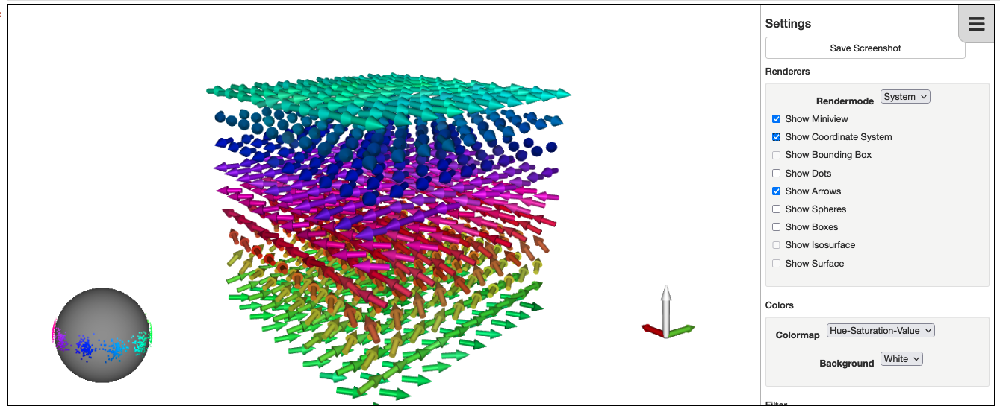

========
Tutorial
========

Find the magnetic groud state with a LLG calculation
++++++++++++++++++++++++++++++++++++++++++++++++++++

We want to compute the ground state magnetic structure of bcc Fe using an LLG calculation.
This page contains a simple tutorial example for your code. The source code can be found under ``example_LLG.py`` in the examples folder.

Step 1 - prepare parameters
---------------------------

The parameters for the simulation are given inside an `AiiDA Dict <https://aiida.readthedocs.io/projects/aiida-core/en/latest/topics/data_types.html#core-data-types>`_ whose nested keys follow the structure of the spirit TOML input file (sections ``geometry``, ``hamiltonian``, ``method``, ``logging``). They set up the spirit calculation, define the Hamiltonian and allow to include external parameters like applying an external magnetic field. The parameters that can be set are listed in the `spirit documentation <https://spirit-docs.readthedocs.io/en/latest/core/docs/Input.html>`_. The given values are merged over the plugin defaults in ``aiida_spirit/data/input_defaults.toml``. Some parameters are set automatically by the plugin (the structure, the coupling tables and the output locations) and cannot be set in the input parameters.

Since version 0.3 the plugin writes spirit's TOML input and needs a spirit version that reads it (the ``develop`` branch); the flat keys of the legacy ``.cfg`` input (e.g. ``llg_temperature``) are rejected.

::

	# prepare parameters
	parameters = Dict({
	    # change spin moment to have the right size for Fe
	    'geometry': {'mu_s': 2.2},
	    # external field of 5 mT in z direction
	    'hamiltonian': {'external_field': {'magnitude': 0.005, 'direction': [0.0, 0.0, 1.0]}},
	    'method': {
	        'llg': {
	            # temperature noise (in K)
	            'temperature': 50,
	            # limit the number of iterations
	            'n_iterations': 2000,
	        }
	    },
	})
	inputs['parameters'] = parameters

Step 2 - set structure
----------------------

For the case of the Fe bcc we don't need to input a structure as that's the structure set by default in ``helpers.py``.
If we wanted to use a different structure, we would have to give a valid `AiiDA StructureData <https://aiida.readthedocs.io/projects/aiida-core/en/latest/topics/data_types.html#structuredata>`_ as in the example below.
::

	# set structure
        a = 2.856 # lattice constant of bcc Fe in Ang.
	structure = StructureData(cell=[[a, 0.0, 0.0],
	                                [0.0, a, 0.0],
	                                [0.0, 0.0, a]])
	structure.append_atom(position=[0.0, 0.0, 0.0], symbols='Fe')
	structure.append_atom(position=[a/2, a/2, a/2], symbols='Fe')

	inputs['structure'] = structure

Step 3 - create jij inputs
--------------------------

The interaction pairs are given to the spirit input file using a separate file. The jij inputs by default are also the ones corresponding to the Fe bcc, so in this example we don't need to pass them.
For other cases, we will need to pass a valid `AiiDA ArrayData <https://aiida.readthedocs.io/projects/aiida-core/en/latest/topics/data_types.html#arraydata>`_ containing the interaction pairs.
Each row of the array ``Jij_expanded`` is one bond from atom ``i`` to atom ``j`` in the unit cell shifted by ``(da, db, dc)``, with the columns ``i, j, da, db, dc, Jij [, Dx, Dy, Dz]`` (in that order; energies in meV). The DMI vector is used if the three columns ``Dx, Dy, Dz`` are present.

Spirit counts every listed bond once, with the energy

.. math:: E_{ij} = -J_{ij}\,\mathbf n_i\cdot\mathbf n_j - \mathbf D_{ij}\cdot(\mathbf n_i\times\mathbf n_j) - \mathbf n_i^{\mathsf T} K_{ij}\,\mathbf n_j = -\mathbf n_i^{\mathsf T}\mathcal J_{ij}\,\mathbf n_j ,

so a bond listed in both directions is counted twice. The rows are passed to spirit as they are.

Instead of ``Jij`` and the DMI vector, the full exchange tensor can be given as an additional array ``Jij_tensor`` (shape ``(n, 3, 3)``, one tensor per row of ``Jij_expanded``; then ``Jij_expanded`` only needs the five index columns). The plugin splits it into the isotropic part :math:`J=\tfrac13\operatorname{tr}\mathcal J`, the DMI vector :math:`D_x=\tfrac12(\mathcal J_{yz}-\mathcal J_{zy})` (and cyclic) and the symmetric traceless two-site anisotropy :math:`K=\tfrac12(\mathcal J+\mathcal J^{\mathsf T})-J\,\mathbb 1`. Note that the DMI vector of aiida-kkr's ``JijData`` is twice this one.

In the example below we use a ``numpy`` array with the data to create the ``jij_data`` input node. **The ``jij_data`` ArrayData needs to set the `Jij_expanded` array which is used in the spirit calculation! No other name is allowed.**
::

	# create jij inputs
        # the jijs_expanded should have the columns i, j, da, db, dc, Jij [, Dx, Dy, Dz]
        # here we omit the DMI vectors and only use Jij couplings
	jijs_expanded = np.array([
            [0, 1, 0, 0, 0, 10.0],
            [0, 0, 1, 0, 0,  5.0],
            [0, 1, 1, 0, 0, 10.0],
            [0, 0, 0, 1, 0,  5.0],
            [0, 1, 0, 1, 0, 10.0],
            [0, 0, 0, 0, 1,  5.0],
            [0, 1, 0, 0, 1, 10.0],
        ])
	jij_data = ArrayData()
	jij_data.set_array('Jij_expanded', jijs_expanded)

	inputs['jij_data'] = jij_data

Step 4 - output results
-----------------------

After running the calculation
::

	result = engine.run(CalculationFactory('spirit'), **inputs)

we may want to ouput some results. Spirit provides the output of the calculation in the output nodes ``output_parameters`` and ``magentization`` where the initial and final magnetization is stored for each spin in the simulation. We can use this information for the final configuration and using ``numpy.mean`` calculate the mean magnetization.
::

	# output results
        spins_final = result['magnetization'].get_array('final')
	mag_mean = np.mean(spins_final, axis=0)

	print(f'mean magnetization direction: {mag_mean}')

This example can be used as a starting point to calculate LLG simulations for different structures and using different parameters. All is needed is to modify the inputs according to the system we want to simulate.

Special run modes of Spirit
+++++++++++++++++++++++++++

OpenMP parallelization
----------------------

The Spirit code supports OpenMP parallelization if it was compiled properly. In AiiDA-Spirit this can then be used via the ``metadata.options`` input to a ``SpiritCalculation`` process::

    builder.code = Code.get_from_string('spirit@some-computer')
    builder.metadata.options = {
        'withmpi': False, # Spirit does not support MPI
        'resources': {'num_machines': 1, 'tot_num_mpiprocs': 1}, # single MPI process
        'queue_name': 'my-queue-name',  # select a partition
        'max_wallclock_seconds': 3600, # set the max runtime (here: 1 h)
        'custom_scheduler_commands': 'export OMP_NUM_THREADS=12' # control the number of OpenMP threads
    }

Pinning
-------

AiiDA-Spirit also support special modes of the Spirit code like pinning of certain spins. Pinning is set using the ``pinning`` ArrayData input to the ``SpiritCalculation``::

    pinning = ArrayData()
    pinning.set_array('pinning', np.array([
        # the columns need to be (i, da, db, dc, Sx, Sy, Sz)
        [0, 0, 0, 0, 1, 0, 0],
        [0, 1, 0, 0, 0, 1, 0],
        [0, 2, 0, 0, 0, 0, 1],
        [0, 3, 0, 0, 1, 1, 1], # the direction is automatically normalized
    ]))
    builder = CalculationFactory('spirit').get_builder()
    builder.pinning = pinning

**Attention:** Pinning needs a special compilation mode of the Spirit code. See https://spirit-docs.readthedocs.io/en/latest/core/docs/Input.html#pinning-a-name-pinning-a for details.

Defects
-------

Defects and disorder is supported with AiiDA spirit using the ``defects`` ArrayData input to the ``SpiritCalculation``::

    defects = ArrayData()
    defects.set_array('defects', np.array([
        # i, da, db, dc, itype
        # cut a hole by setting vacancy defects (i.e. itype<0)
        [0, 2, 2, 2, -1],
        [0, 2, 2, 3, -1],
    ]))
    builder = CalculationFactory('spirit').get_builder()
    builder.defects = defects

Disorder can be specified with the atom type index in the ``defects`` array and the types can be specified with the corresponding ``atom_types`` array (see help string of the ``defects`` input port of the ``SpiritCalculation`` for more details.

**Attention:** The Defects mode needs a special compilation mode of the Spirit code. See https://spirit-docs.readthedocs.io/en/latest/core/docs/Input.html for details.

Plotting
++++++++

AiiDA-Spirit comes with an interactive plotting tool that can be used from jupyter notebooks. An example notebook is given in ``aiida-spirit/examples/AiiDA-Spirit_show_spins_example.ipynb``.

To use the spin visualization tool you first need to initialize the widget::

    from aiida_spirit.tools.plotting import init_spinview, show_spins
    init_spinview()

Then wait for the widget to load. Once it is loaded you can populate it with a call of ``show_spins`` (here ``spirit_calc`` is assumed to be a finished SpiritCalculation)::

    show_spins(spirit_calc, scale_spins=0.8)

